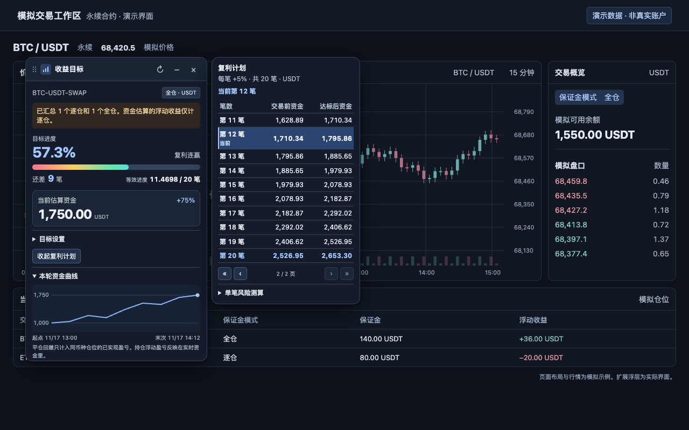

# 交易目标 · OKX 实时进度

在 OKX 永续合约交易页设定一个资金目标，直接看离目标还有多远。复利连赢模式会把当前资金换算成等效进度，显示按每笔目标收益率还差几笔。面板也支持按百分比或固定金额设定增长目标。

**[下载 v2.2.15 安装 ZIP](https://github.com/mxjl620/okx-trade-goal/releases/download/v2.2.15/okx-trade-goal-2.2.15.zip)** · Chrome 130 或更新版本 · [版本说明](https://github.com/mxjl620/okx-trade-goal/releases/tag/v2.2.15) · [隐私政策](PRIVACY.md)

## 安装与使用

1. 从 [GitHub Release](https://github.com/mxjl620/okx-trade-goal/releases/tag/v2.2.15) 下载扩展安装 ZIP 并解压。
2. 在 Chrome 打开 `chrome://extensions`，开启「开发者模式」。点「加载已解压的扩展程序」，选择包含 `manifest.json` 的文件夹。
3. 登录 OKX，打开或刷新永续合约交易页。阅读首用授权说明，选择「同意并启用」，再打开下方的「当前仓位」。将交易类型和保证金模式设为全部，取消「当前交易品种」和「按币种分组」，让扩展看到完整仓位。
4. 在「目标设置」里填写起始资金和目标，点「保存目标」。要更新平仓回撤，打开 OKX 的「历史仓位」并加载本轮相关记录。

拖动「收益目标」标题可移动浮层，位置会在刷新后保留。点「−」收起后仍可看到进度、剩余笔数和回撤提醒。复利模式下，点「差 X 笔」可打开复利计划，展开主面板时会保留边栏和当前页。点「×」会关闭面板并暂停读取。要恢复，在 Chrome 工具栏打开扩展并选「展开当前页面板」。

手动升级时，用新版文件替换原安装目录中的扩展文件，在 `chrome://extensions` 重新加载原条目，再刷新 OKX 页面。使用另一安装目录会产生独立的扩展条目和数据。

## 三种目标

| 方式 | 如何计算目标资金 |
| --- | --- |
| 复利连赢 | 起始资金 × (1 + 单笔目标收益率) ^ 目标笔数 |
| 增长百分比 | 起始资金 × (1 + 目标涨幅) |
| 增长金额 | 起始资金 + 目标增加金额 |

复利计划每页列 10 笔，逐笔展示交易前与达标后的计划资金，金额固定显示两位小数。例如以 1,000 USDT 起步、每笔目标 5%，第 1 笔是 1,000.00 → 1,050.00 USDT。边栏会高亮当前所在的一笔。等效笔数由资金变化换算，实际连赢次数要查已平仓记录。

复利边栏中的「单笔风险测算」可按单笔盈利目标与假设胜率计算复利盈亏平衡线，也可按回撤预算和假设连亏笔数计算单笔亏损比例上限。两项结果以每笔交易前的账户净值为基数，使用扣费后的盈亏。测算输入只保留在当前页面。

## 资金、曲线与回撤

当前资金根据下单区的「可用」和「当前仓位」估算，只加总与可用余额同币种的仓位。

| 当前仓位 | 当前资金 |
| --- | --- |
| 无仓位 | 可用余额 |
| 只有逐仓 | 可用余额 + 逐仓保证金 + 逐仓浮动盈亏 |
| 只有全仓 | 可用余额 + 全仓保证金 |
| 同时有逐仓和全仓 | 可用余额 + 所有仓位保证金 + 逐仓浮动盈亏 |

面板分别展示逐仓与全仓的保证金和浮动盈亏。全仓浮动盈亏供核对，不再单独加入估算。浮亏按负数计入。如果页面显示了浮动盈亏字段，但金额为「—」或「N/A」，该金额按 0 处理。页面加载、筛选或字段无法确认时，面板会提示原因，数值精度以 OKX 页面为准。

首次保存目标时，以填写的起始资金开启本轮。资金曲线随实时估算资金变化，通常每分钟保存一个变化点。「平仓回撤」则用本轮同币种、已全部平仓记录的已实现收益计算。持仓中的浮盈浮亏不会触发平仓回撤，刷新或翻页也不会重复计入已识别的仓位。

扩展只读取「历史仓位」里已经加载的记录。如果本轮较早的平仓尚未显示，请取消筛选并继续滚动加载。修改目标会保留本轮记录。「开始新一轮」会以当前估算资金开启新曲线，平仓回撤以上一轮已实现资金为基准，只计入新一轮开始后平仓的记录。

## 数据与排查

授权后，扩展在本机读取 OKX 永续交易页已显示的字段，计算目标进度和回撤。目标和本轮记录使用 AES-GCM 加密保存在当前 Chrome 配置文件。扩展不上传交易数据，不读取或保存账号凭据，无需 API 密钥，也不下单。这是独立的第三方项目，与 OKX 无隶属关系。

目标和本轮记录按币种保存。需要隔离不同 OKX 账户的记录时，请使用不同的 Chrome 配置文件。

读不到数据时，先确认下方当前打开的是「当前仓位」且未筛掉仓位，再点浮层的刷新按钮。仍有问题可展开「读取诊断」，复制版本和页面标记数量，并附在 [GitHub Issue](https://github.com/mxjl620/okx-trade-goal/issues) 中。这段诊断不含余额、订单金额或账户标识。

## 本地开发

- 直接用 Chrome 加载包含 `manifest.json` 的仓库根目录，无需构建。
- 运行 `node --test tests/*.test.cjs` 测试目标、风险与回撤计算。
- 在 Chrome 打开 `tests/okx-history.html`，用模拟页面验证平仓记录读取。
- 运行 `python3 scripts/package.py ./okx-trade-goal-2.2.15.zip` 生成可解压加载的扩展安装包。

## 打赏支持

如果你愿意支持项目维护，可使用 **BNB Smart Chain（BSC 主网）**，在钱包中粘贴以下收款地址。

`0x37acef0a7d985b514f93301d1bc375d8d7a9f582`

[在 BscScan 查看地址](https://bscscan.com/address/0x37acef0a7d985b514f93301d1bc375d8d7a9f582)
